# Zybo Z7 VHDL NPU 가속기 : 실측 진동 분류 기반 모터 제어 시스템

### VHDL FFT / INT8 NPU and Closed-Loop Motor Control on Zynq-7000


Zybo Z7, 모터 드라이버·모터, 전원 공급기와 오실로스코프로 구성한 실험 시스템입니다.

**실측 진동 → 64-point FFT → INT8 신경망 → 경고·출력 제한·정지까지 연결한 FPGA/SoC 시스템**

MPU-6500으로 모터 하우징의 진동을 수집하고, Zybo Z7-20의 PL에서 주파수 특징 추출과
신경망 추론을 수행합니다. FFT·INT8 NPU·인코더 속도 추정·PI 제어·PWM·안전 supervisor를
VHDL 모듈로 구성해 진동 분류와 모터 제어를 한 보드에 통합합니다.
ARM은 센서 설정·데이터 이동·로그를 담당합니다.

> **VHDL RTL / Zybo Z7-20 / PL 100 MHz / XSim 13개 시험 PASS**<br>
> **저장된 보드·구현 기록(2026-09-17): FFT+NPU 833 cycles · INT8 118/120 · WNS +0.091 ns · WHS +0.020 ns**

분류 대상은 **정상 운전과 의도적으로 주입한 32 Hz 토크 리플**입니다.
Vivado/XSim 화면, 오실로스코프 계측 사진, MATLAB 기준값 그래프를 함께 제공합니다.
각 자료의 검증 대상·날짜·원본은 [화면·보고서 출처](docs/SCREENSHOT_PROVENANCE.md)에 정리했습니다.

## 0. 목차

1. [동작 시나리오](#1-동작-시나리오)
2. [핵심 기술 요약](#2-핵심-기술-요약)
3. [프로젝트 개요](#3-프로젝트-개요)
4. [주요 기능](#4-주요-기능)
5. [시스템 구성](#5-시스템-구성)
6. [아키텍처](#6-아키텍처)
7. [FFT와 INT8 MLP 데이터 형식](#7-fft와-int8-mlp-데이터-형식)
8. [AXI4-Lite 인터페이스](#8-axi4-lite-인터페이스)
9. [모터·안전 제어](#9-모터안전-제어)
10. [처리 순서와 상태 전이](#10-처리-순서와-상태-전이)
11. [실행 구조와 소스 구성](#11-실행-구조와-소스-구성)
12. [핵심 설계 포인트](#12-핵심-설계-포인트)
13. [Troubleshooting](#13-troubleshooting)
14. [검증 및 성능 분석](#14-검증-및-성능-분석)
15. [빌드와 소프트웨어 연동](#15-빌드와-소프트웨어-연동)

## 1. 동작 시나리오

1. ARM이 MPU-6500의 X축 raw 64개를 수집하고 공유 BRAM에 기록합니다.
2. AXI START를 받은 PL이 FFT, 4개 대역 특징, INT8 MLP를 순서대로 계산합니다.
3. PL의 safety supervisor가 분류 완료 시점마다 연속 이상 횟수를 갱신합니다.
4. 이상 1회는 warning, 2회 연속이면 요청 PWM을 최대 25%로 제한하고, 3회 연속이면 정지 상태를 유지합니다.
5. ARM heartbeat가 500 ms 동안 끊어져도 PL이 독립적으로 모터를 차단합니다.
6. SW0 OFF로 latch를 해제한 뒤 ON으로 다시 arm합니다.

모터 속도 제어는 encoder C1 → hybrid 속도 추정 → PI/anti-windup → PWM 경로로 실행됩니다.
Encoder C1/C2의 직교 위상은 방향·illegal transition·timeout·overflow 진단에 사용합니다.

## 2. 핵심 기술 요약

| 영역 | 구현 내용 | 설계 의도 |
|---|---|---|
| SoC 분담 | Cortex-A9 + AXI4-Lite + dual-port BRAM | 데이터 수집과 정수 가속 경로 분리 |
| 주파수 분석 | 64-point radix-2 FFT, Q1.15 twiddle | FPGA에 맞는 고정소수점 연산과 중간값 검증 |
| 신경망 | `4 → 4 ReLU → 2`, INT8, MAC PE 2개 | 작은 구조로 누산·포화·재양자화 과정을 추적 |
| 제어 | hybrid encoder 추정, PI, anti-windup, 20 kHz PWM | 같은 PL에서 속도 피드백과 출력 제한 처리 |
| 안전 | 연속 이상 판정, latch, PS heartbeat watchdog | 분류 결과와 PS 정지를 각각 감시 |
| 실험 | 런타임 Kp/Ki, open-loop override, telemetry | 재합성 없이 게인 비교·시스템 식별 |
| 검증 | MATLAB/C/RTL 비교, XSim, post-route, 실물 측정 | 계산·논리·타이밍·물리 응답을 단계별 확인 |

FPGA 회로는 **VHDL RTL**로 구성합니다. 고정소수점 FFT와 2-PE INT8 NPU,
AXI4-Lite 레지스터, SPI, 인코더·PI·PWM·안전 회로를 기능별 모듈로 연결합니다.
C 골든 모델은 [역할별 함수](fourier/firmware/README.md)로 구성하고 RTL의 중간값·결과와 비교합니다.
ARM 앱은 플랫폼·센서·추론·텔레메트리·모터 명령으로 나누며, `main.c`에는 초기화와 명령 분기를 둡니다.
[VHDL RTL 설계·검증](docs/VHDL_DESIGN.md)

회로는 최상위 `*_struct.vhd`와 기능별 `*_fsm.vhd`·`*_rtl.vhd`로 나누었습니다.
상태·계산·카운터를 이름 있는 프로세스로 구분했으며,
[모듈 연결과 프로세스 구성](fourier/vhdl/README.md)에서 실제 파일로 이동할 수 있습니다.

학습은 PC에서 수행하고 FPGA에는 추론 회로를 구현합니다.
PS와 PL은 AXI4-Lite 레지스터와 dual-port BRAM으로 명령·입력·결과를 주고받습니다.

## 3. 프로젝트 개요

| 항목 | 내용 |
|---|---|
| 프로젝트명 | Project07_VibrationNPU |
| 대상 보드 / 소자 | Digilent Zybo Z7-20 / XC7Z020-1CLG400C |
| CPU / PL clock | ARM Cortex-A9 / 100 MHz |
| 센서 / 입력 | MPU-6500 X축 signed INT16, 64 samples/frame |
| NPU | 4→4→2 INT8 MLP, MAC PE 2개 |
| 구현 언어 | PL: VHDL / PS: C / 분석·검증: MATLAB·Python / 빌드: Tcl |
| 분류 결과 | normal / injected torque ripple |
| 제어 대상 | L298N + encoder DC motor |
| 개발 도구 | MATLAB·Simulink, Vivado 2024.2, XSim, Vitis, Python |
| 원본 검증 데이터 | 정상·주입 이상 각 3 runs, 총 360 windows |

진동 분류의 계산 일치, 분류 성능, 안전 동작, 모터 응답을 각각 검증합니다.
평가 데이터는 모터 하우징에 고정한 MPU-6500 X축의 정상·주입 토크 리플 기록입니다.

## 4. 주요 기능

- **실측 입력 수집**: 샘플 간격과 원본 CSV 출처를 함께 기록합니다.
- **고정소수점 FFT/NPU**: butterfly부터 logits까지 정수 Golden과 비교합니다.
- **NPU 중간값 관측**: FFT real/imag, 4-band feature, hidden, logits, class를 분리해 확인합니다.
- **폐루프 제어**: 인코더 속도 추정과 PI/anti-windup을 PL에 구현합니다.
- **단계별 안전 출력**: warning → 25% 제한 → latch 정지와 독립 heartbeat watchdog을 제공합니다.
- **실험 재현**: 기존 실측 run과 모터 telemetry를 별도 MATLAB·Simulink 모델에서 재생합니다.
- **설명 가능한 코드**: 함수 입출력·단위·수식·주의점을 한국어 `% [주N]` 각주로 읽을 수 있습니다.

## 5. 시스템 구성

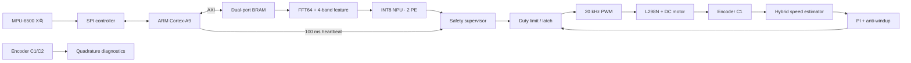


| 보드 연결 | 용도 |
|---|---|
| JE1–4 | MPU-6500 SPI: SCLK, MOSI, MISO, CS |
| JD1–3 | L298N: PWM/ENA, IN1, IN2 |
| JD4 / JD7 | Encoder C1 / C2 |
| SW0 / BTN0 | arm·clear / 정지 |
| SW3 | 25%↔75%, 32 Hz 토크 리플 주입 |

센서 WHO_AM_I 실측은 `0x70`으로 MPU-6500입니다. 배선·전압·스위치 모드는
[하드웨어 가이드](docs/HARDWARE.md)와 [제어 확장 실험](docs/CONTROL_EXTENSION_EXPERIMENT.md)을 따릅니다.
초기 고정 duty 시험과 최종 PI 속도 제어 모드는 구분해서 해석합니다.

## 6. 아키텍처

### 6-1. Zynq PS/PL 실제 Block Design


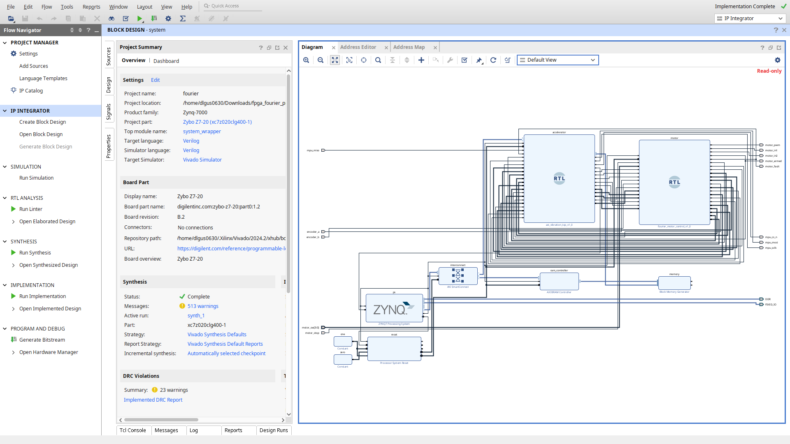

저장된 `build/fourier/.../system.bd`를 Vivado 2024.2에서 연 화면입니다. Processing System,
AXI interconnect, BRAM controller/memory, 직접 작성한 accelerator와 motor 모듈의 실제 연결을 보여 줍니다.
[확대 가능한 Vivado 원본 SVG](docs/images/vivado_block_design.svg)도 함께 제공합니다.

현재 VHDL의 모듈명·신호명·비트 폭·전달 방향은
[모듈·신호 구조도 3장과 전체 신호표](docs/architecture/README.md)에서 확인할 수 있습니다.
실행 순서와 조건은 [핵심 FSM 4장 및 시스템별 동작도 7장](docs/state_diagrams/README.md)에 정리했습니다.


### 6-2. MATLAB·Simulink 정수 NPU 모델


위 그림은 **2026-09-17 MATLAB R2026a에서 저장된 `.slx`의 내장 원본 미리보기**입니다.
[해당 Simulink 모델](docs/evidence/2026-09-17_fourier_npu_algorithm.slx)을 열어 각 블록과 파라미터를 확인할 수 있습니다.

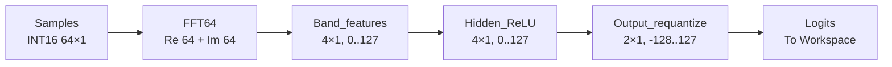

| 실제 블록명 | 계산과 확인 항목 | 대응 코드 |
|---|---|---|
| `Samples` | `VIB_INPUT` 원본 64개, DC 포함 | `RUN_MATLAB_CHECKS.m` |
| `FFT64` | scaled radix-2 FFT, Re/Im 순서로 128개 출력 | `fourier_fft_sl.m`, `fft64_fixed.m` |
| `Band_features` | 4개 대역의 L1 합 → shift → 포화 | `fourier_features_sl.m` |
| `Hidden_ReLU` | `floor((W1*f+b1)/2^shift1)` → ReLU·포화 | 모델에 포함된 정수 가중치 |
| `Output_requantize` | `floor((W2*h+b2)/2^shift2)` → signed INT8 포화 | 모델에 포함된 정수 가중치 |
| `Logits` | 두 최종 점수를 MATLAB Golden과 비교 | `sl_logits` |

20개 기준 입력을 MATLAB 함수와 Simulink에 차례로 넣고 FFT 성분과 층별 정수 값을 비교합니다.
RTL의 NPU 처리 지연은 XSim의 클럭 기준으로 검사하며, 기준값은 **18 cycles**입니다.

### 6-3. 실측 전용 Simulink 재생 구조

아래는 [`build_measured_models.m`](matlab/measured/build_measured_models.m)의 연결을 설명한 도식입니다.
`RUN_MEASURED_STUDY`가 재생 모델을 생성하고 `EXPORT_README_FIGURES`가 루트·하위 블록 그림을 내보냅니다.

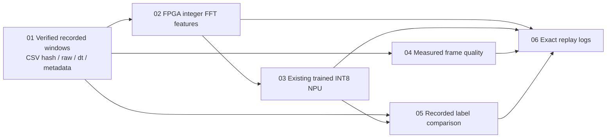

| 계층 | 들어가는 기록 | 나오는 값과 읽는 이유 |
|---|---|---|
| `01_Verified_recorded_windows` | 원본 64 counts, `dt_us`, window ID·label·host 시각 | 보간 없이 원본 프레임과 시간 메타데이터를 분리 |
| `02_FPGA_integer_FFT_features` | raw 64개 | FFT Re/Im 128개와 4-band feature, FPGA와 동일 전처리 |
| `03_Existing_trained_INT8_NPU` | feature 4개, 기존 `model.json` | hidden 4개, logits 2개, 동점 class 0 |
| `04_Measured_frame_quality` | raw와 실제 샘플 간격 | DC, AC RMS, ADC rail count, dt 평균·최소·최대·흔들림 |
| `05_Recorded_label_comparison` | 예측과 기록 label | truth/prediction/correct; 재학습 없이 기존 검증 재현 |
| `06_Exact_replay_logs` | 모든 중간 신호 | MATLAB 배열과 원본·정수 중간값이 같은지 비교 |

모터 기록은 `measured_motor_telemetry_replay`에서 따로 재생합니다.
`Original_motor_telemetry → Recorded_control_channels → Recorded_speed_PWM_integral`로
목표·실제 속도·PWM·적분값과 arm/fault/enabled를 표시합니다.
진동과 모터 기록은 각각 원본 실험의 프레임·샘플 순서와 시간 메타데이터를 따라 재생합니다.

**재생 tick 1개는 원본 record 1개**입니다.
모터의 `time_s=sample/100`은 원본 수집 프로그램의 명목 시간입니다.

## 7. FFT와 INT8 MLP 데이터 형식

| 단계 | 형식·크기 | 처리 |
|---|---|---|
| 센서 입력 | signed INT16 × 64 | ±2 g 설정, 16384 count/g |
| FFT | signed INT16 real/imag | bit-reversed load, 6단 butterfly마다 `/2`, 최종 `FFT(x)/64` |
| 대역 특징 | 4개 | bin `1..6`, `7..12`, `13..20`, `21..31`의 `abs(Re)+abs(Im)` 합 |
| 특징 양자화 | 0..127 | 대역 합을 5-bit 우시프트 후 포화 |
| 은닉층 | INT8 weight, INT32 누산 | 4×4 MAC, shift, ReLU, 0..127 포화 |
| 출력층 | signed INT8 logits × 2 | 2×4 MAC, shift, -128..127 포화 |
| 분류 | 0 또는 1 | class 1 점수가 더 클 때만 1, 동점이면 0 |

명목 1 kHz에서 FFT bin 간격은 15.625 Hz입니다. NPU 특징은 대역별 L1 크기 합입니다.
하드웨어 재현 경로에는 DC를 포함한 원본 입력을 넣고, MATLAB 진단용 PSD에는 평균 제거와
Hann 창을 적용합니다. 수치 계약은 [DESIGN.md](DESIGN.md), 읽기 설명은
[스터디 코드 각주 안내](docs/STUDY_CODE_NOTES.md)에 있습니다.

## 8. AXI4-Lite 인터페이스

AXI control base는 `0x43C00000`, 공유 BRAM base는 `0x40000000`이며 각각 4 KiB입니다.

| 주소/영역 | 역할 |
|---|---|
| control `+0x00` | START, DONE/error clear |
| status `+0x04` | busy, done, rejected-start, latch, warning, derated, watchdog |
| `+0x08 / +0x0C / +0x10` | class / 전체 cycle / NPU cycle |
| `+0x20..0x2C / +0x30..0x34` | feature / logits |
| `+0x40 / +0x44` | SPI command / response |
| `+0x48 / +0x4C` | heartbeat / safety telemetry |
| BRAM word `0..63` | 입력 samples |
| BRAM word `256..266` | feature, hidden, logits, class |

START는 idle에서만 수락하고 DONE은 결과 기록이 끝난 뒤 올라갑니다. AXI AW/W를 독립 수신하며
B/R backpressure 동안 응답을 유지합니다. BRAM 접근권은 가속기 busy 동안 PL이 소유합니다.
런타임 PI·encoder 확장 레지스터는 [실험 가이드](docs/CONTROL_EXTENSION_EXPERIMENT.md)에서 확인합니다.

## 9. 모터·안전 제어

| 조건 | 출력과 상태 |
|---|---|
| 정상, arm 완료 | PI 요청 duty 적용 |
| class 1 첫 번째 | warning, duty 제한 없음 |
| class 1 두 번째 연속 | warning + derated, duty 최대 25% |
| class 1 세 번째 연속 | classifier latch, PWM·구동 출력 차단 |
| latch 이전 class 0 | 연속 횟수·warning·derated 복구 |
| arm 중 heartbeat 500 ms 단절 | watchdog latch, 분류와 독립 차단 |
| latch 이후 class 0 | 정지 상태 유지 |
| SW0 OFF → ON | clear 후 재arm |

안전 판단은 분류 완료 이벤트마다 갱신합니다.
종단 차단 지연은 윈도우 수집·호스트 명령·전송·연속 판정을 포함한 전체 경로의 시간입니다.
자세한 상태 전이는 [안전 supervisor 설계](docs/SAFETY_SUPERVISOR.md)에 있습니다.

## 10. 처리 순서와 상태 전이

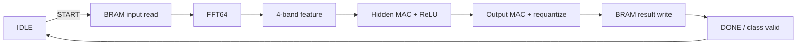

가속기는 입력·계산·결과 기록의 소유권을 순서대로 넘깁니다. 계산 중 재시작 요청을 거부하고,
최종 결과를 기록한 뒤 DONE을 내므로 ARM이 중간 결과를 완료 결과로 읽지 않게 합니다.
안전 supervisor는 `class_valid`가 있는 사이클에만 분류 횟수를 갱신하고 heartbeat는 독립적으로 감시합니다.

## 11. 실행 구조와 소스 구성

| 경로 | 내용 |
|---|---|
| [`fourier/vhdl`](fourier/vhdl/) / [`common/reset_sync.vhd`](common/reset_sync.vhd) | VHDL 회로·공통 패키지·최상위 모듈 연결 |
| [`fourier/tb_vhdl`](fourier/tb_vhdl/) | 기준값·프로토콜·클럭별 출력 검사와 VHDL 단독 TB |
| [`fourier/rtl`](fourier/rtl/) / [`fourier/tb`](fourier/tb/) | 동등성 검증용 참조 RTL·테스트벤치 |
| [`fourier/firmware`](fourier/firmware/) | ARM 앱과 C 기준 모델 |
| [`data`](data/) / [`measurements`](measurements/) | 모델·정수 vector / 실측 원본 |
| [`matlab`](matlab/) | 정수 Golden, Simulink 함수, 연구·실측 스터디 |
| [`vivado`](vivado/) / [`tools`](tools/) | 프로젝트·시뮬레이션·구현 Tcl / 학습·검증·수집 도구 |
| [`docs/images`](docs/images/) / [`docs/evidence`](docs/evidence/) | 실제 화면 / 최종 보고서·회귀 로그 사본 |
| [`artifacts`](artifacts/) | bit/XSA/ELF, 실험 기록, MATLAB 입력 ZIP |

## 12. 핵심 설계 포인트

| 설계 선택 | 이유와 검증 경계 |
|---|---|
| 매 FFT stage의 `/2` | 중간 정수 폭을 제한하며 최종 스케일을 `FFT/64`로 고정합니다. |
| signed floor·포화 규칙 고정 | 음수 shift와 overflow 차이가 추론 오차로 이어지지 않게 합니다. |
| MAC PE 2개 재사용 | 작은 4→4→2 모델의 구조와 cycle을 직접 검증하기 쉽습니다. |
| 학습/검증을 run별 분리 | 같은 acquisition의 인접 window가 양쪽에 섞이는 것을 막습니다. |
| 연속 이상과 latch | 단발 오검출과 지속 이상을 구분하고 SW0 OFF→ON으로 재기동합니다. |
| 수치 모델·실측 재생 분리 | XYZ 동역학 모델과 X축 실측 기록을 각각의 입력·단위로 분석합니다. |
| 원본 해시·기록 보존 | 그림의 값과 구현 revision을 원본 파일로 추적합니다. |

## 13. Troubleshooting

| 관측한 문제 | 확인 과정 | 조치·교훈 |
|---|---|---|
| 이상 검출률이 15%로 저하 | CPU–PL 일치, 샘플 주기 정상, 주파수 대역 에너지 이동 확인 | 센서 재고정 후 이상 60/60; 나사 풀림 자체는 미확인 |
| 500 ms watchdog이 1.5 s처럼 관측 | watchdog counter를 AXI로 직접 노출 | 452..508 ms 확인; 외부 증상으로 잰 이전 시간의 오류 |
| 통합 후 critical path 위반 | PI anti-windup 가산기와 encoder 곱셈·clamp 경로 확인 | 파이프라인 추가, 정수 결과·완료 타이밍 회귀 검증 |
| 게인 변경마다 재합성 필요 | Kp/Ki/anti-windup을 AXI 레지스터로 확장 | 같은 bitstream에서 A/B 비교·식별 실험 가능 |

자세한 원인 배제 과정과 단계별 수치는 [이전 README 기록](docs/README_VALIDATION_HISTORY.md)과
[HANDOFF](HANDOFF.md)에 남겼습니다. 현재 구현 수치는 위 최종 보고서를 기준으로 합니다.

## 14. 검증 및 성능 분석

### 14-1. RTL 시뮬레이션

VHDL RTL은 XSim의 **13개 시험을 통과**했습니다. 기준값 비교와 프로토콜 검사,
클럭별 출력 비교, VHDL 단독 테스트벤치를 함께 실행합니다.

| 테스트벤치 | 주요 검증 |
|---|---|
| `tb_fft_npu_vhdl` | 20개 기준 입력의 feature·hidden·logits·class, NPU 18 cycles |
| `tb_mac` | signed INT8 곱 65,536개, bias·hold |
| `tb_core` | BRAM 소유권·결과 11개 기록·busy·reset abort |
| `tb_axi` | AW/W 독립 수신·backpressure·byte strobe·제어 및 상태 레지스터 |
| `tb_spi` | 읽기·쓰기·16비트 원자적 읽기·reset abort |
| `tb_fault_latch` | 연속 이상 latch |
| `tb_safety_supervisor` | warning·derate·classifier/watchdog latch |
| `tb_core_equivalence` | 20개 입력의 전체 출력·사이클·reset abort 비교 |
| `tb_pid_equivalence` | 2,000회 제어 입력의 클럭별 출력 비교 |
| `tb_motor_equivalence` | 모터·안전 출력과 telemetry의 클럭별 비교 |
| `tb_reset_sync_vhdl` | 초기·비동기 리셋, 두 클럭 동기 해제, 재인가 |
| `tb_mac_pe_vhdl` | reset·clear 우선순위, signed MAC, hold·wrap |
| `tb_fft_npu_native_vhdl` | VHDL 단독 TB: 20개 기준 입력과 NPU 18 cycles |

[13개 시험 로그·소스 지문](docs/evidence/readability_complete_2026-11-15/) ·
[VHDL 설계·검증 상세](docs/VHDL_DESIGN.md)

#### XSim 모터·안전 통합 파형

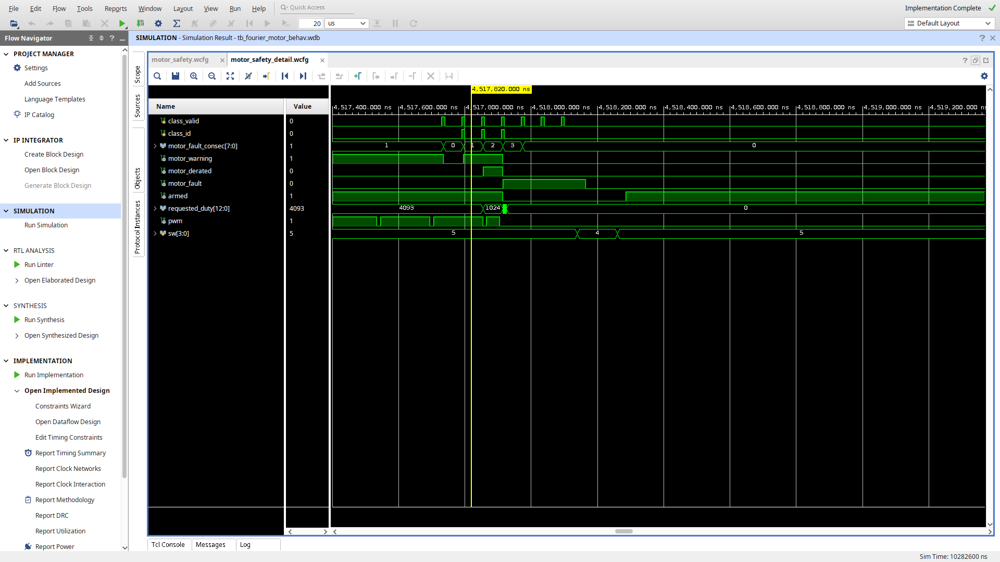

2026-09-17 참조 RTL의 `tb_fourier_motor` 저장 WDB를 XSim에서 연 화면입니다.
`class_valid`·연속 이상 횟수·warning·derated·fault·requested duty·PWM을 함께 관측합니다.
시간축은 테스트벤치의 축약 시간 설정을 따르며, 보드의 실제 PWM·watchdog 값은 계측 절에서 확인합니다.

[참조 RTL FFT/NPU 로그](docs/evidence/2026-09-17_tb_fft_npu.log) ·
[참조 RTL 모터 통합 로그](docs/evidence/2026-09-17_tb_fourier_motor.log)

### 14-2. 구현 타이밍과 자원

#### Vivado Timing Summary 실제 화면


**2026-09-17 19:33의 Verilog 참조 구현 routed checkpoint**에서 확인한 결과입니다.
VHDL 구현의 단위 합성·블록 디자인 검증 자료는 [설계·검증 문서](docs/VHDL_DESIGN.md)에 연결했습니다.

| 항목 | 최종 저장 결과 | 해석 |
|---|---:|---|
| Clock | 100 MHz / 10 ns | `clk_fpga_0` |
| WNS | **+0.091 ns** | 최악 setup 여유 |
| TNS / setup 실패 endpoint | 0.000 ns / 0 | 제약된 setup 검사 통과 |
| WHS | **+0.020 ns** | 최악 hold 여유 |
| THS / hold 실패 endpoint | 0.000 ns / 0 | 제약된 hold 검사 통과 |
| WPWS | +3.750 ns | 최악 pulse-width 여유 |
| DRC | Error 0, Warning 23 | 원본 DRC 보고서 기준 |
| LUT | 12,201 / 53,200 (22.93%) | 최종 utilization 보고서 |
| Register | 8,187 / 106,400 (7.69%) | 최종 utilization 보고서 |
| BRAM tile / DSP | 1 / 8 | 최종 utilization 보고서 |

**WNS**는 데이터가 다음 캡처 에지보다 충분히 일찍 도착하는지 확인하는 setup slack의 최솟값입니다.
**WHS**는 캡처 에지 직후 필요한 시간 동안 데이터가 유지되는지 확인하는 hold slack의 최솟값입니다.
저장된 구현의 setup·hold 여유는 각각 +0.091 ns와 +0.020 ns입니다.

위 통과 결과는 설정된 타이밍 제약 범위에 대한 것입니다. 원본 `check_timing`에는 input 8개·output 7개의
false-path 예외가 기록되어 있습니다. [Timing](docs/evidence/2026-09-17_timing.rpt) ·
[Utilization](docs/evidence/2026-09-17_utilization.rpt) · [DRC](docs/evidence/2026-09-17_drc.rpt) ·
[Check timing](docs/evidence/2026-09-17_check_timing.rpt)

단계별 측정·분석 과정은 [검증 이력](docs/README_VALIDATION_HISTORY.md)에 정리했습니다.

### 14-3. 실물 계측

#### 오실로스코프: JD1 PWM 실측

UART `x`로 저장된 실제 이상 윈도우를 PL FFT/NPU에 세 번 입력하면서 JD1을 프로브로 측정했습니다.
아래는 **2026-09-15 classifier latch 경로 시험**의 원본 계측 사진입니다.

| 정상 출력 50.0% | 제한 출력 25.0% | latch 정지, 정적 LOW |
|---|---|---|
| 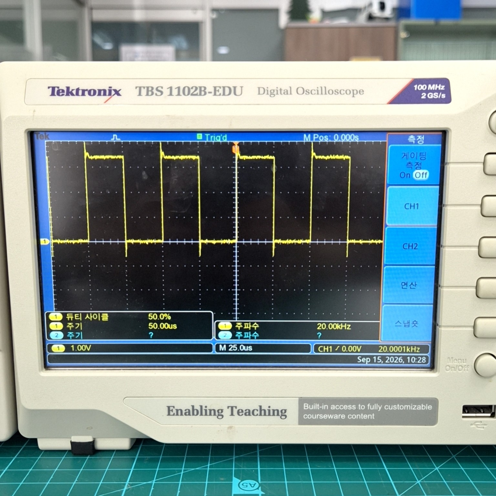 | 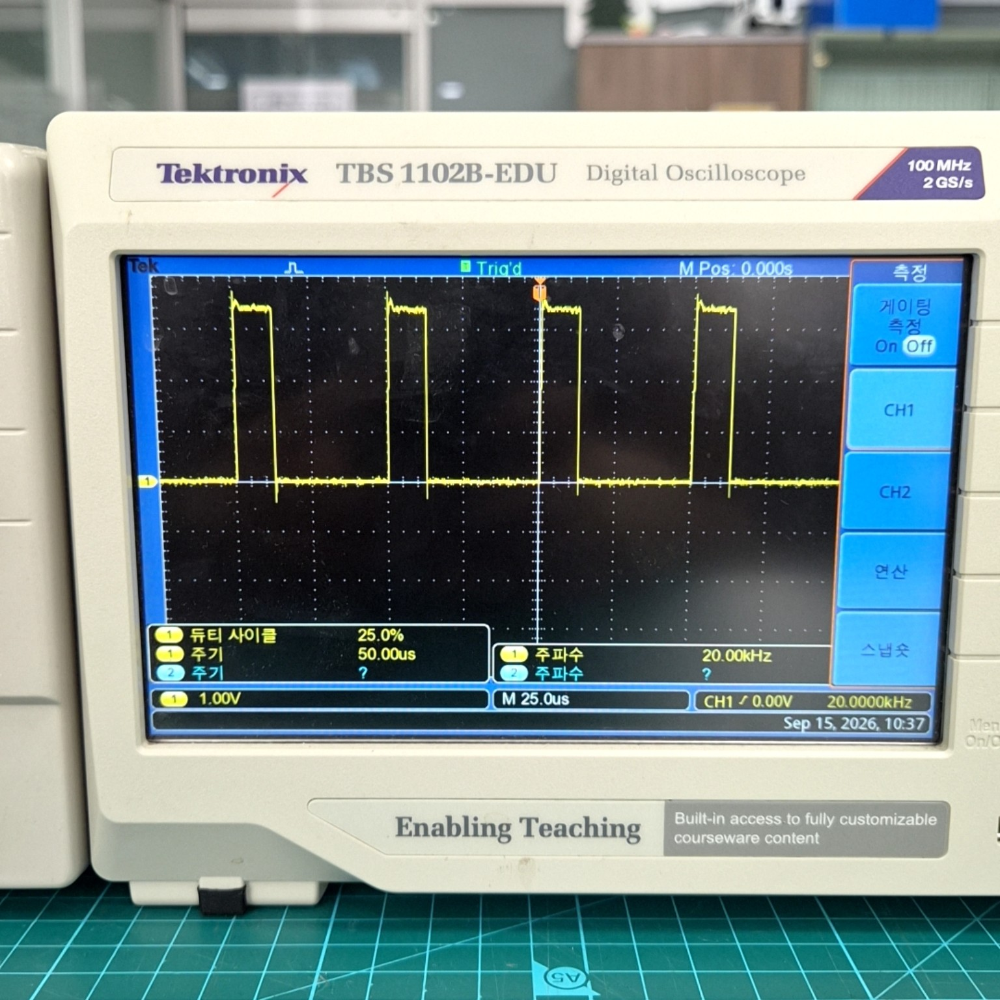 | 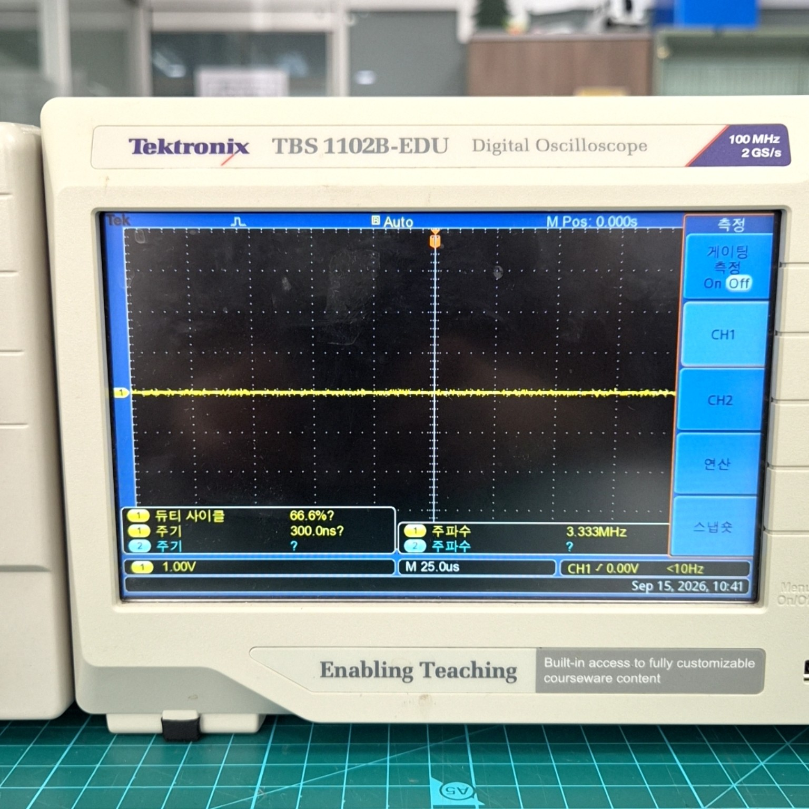 |

warning 단계에서는 50%가 유지되고, derate에서 25%, latch에서 PWM이 LOW가 되었습니다.
정지 상태는 JD1의 정적 LOW 파형과 모터 구동 정지 기록으로 확인했습니다.
[시험 절차·원본 기록](artifacts/safety_supervisor_hardware_2026-09-15.md)

#### 분류 데이터와 연산 성능

| 항목 | 결과·조건 |
|---|---|
| 실제 데이터 | 정상 3 run 180 windows + 토크 리플 3 run 180 windows |
| 학습/검증 분리 | run 1·2 학습 / run 3 검증, 이웃 window 무작위 혼합 없음 |
| FP32 / INT8 검증 | 119/120 (99.17%) / **118/120 (98.33%)** |
| INT8 혼동행렬 | 정상 58/60, 주입 이상 60/60; 정상 오검출 2개 |
| 저장 데이터 보드 replay | 100/100 CPU–PL 결과 일치 |
| 센서 재고정 후 별도 실시간 시험 | 이상 60/60, 정상 28/30, 전체 97.8% |
| 실측 sample 간격 | 평균 약 998.8 μs, 약 1001.2 Hz |
| PL FFT+NPU / NPU만 | 833 cycles = 8.33 μs / 18 cycles @ 100 MHz |
| 가속기 end-to-end | 26.38 μs, ARM 소프트웨어 847 μs 대비 약 32배 |

98.33%는 기존 검증 run의 120개 window에 대한 결과이며, 실측 재생에서도 같은 데이터와 모델을
사용합니다. [실측 데이터 분리](docs/REAL_DATASET.md) ·
[실물 분류 기록](artifacts/hardware_validation_2026-09-14.md) · [성능 측정](docs/PERFORMANCE.md)

#### 모터 제어·안전 실험

| 실험 | 관측 결과 |
|---|---|
| 폐루프 속도 추종 | reference 2048 대비 measured 2040..2045, 오차 0.4% 이내 |
| classifier 정지·재arm | 전류 0.13 A → 0.01 A, clear/rearm 후 0.13 A |
| PS 정지 watchdog | AXI 카운터 기준 452..508 ms에서 trip, 설계 500 ms와 일치 |
| 12→9→12 V 외란, 독립 2회 | duty 64.2→85.8%, 속도 최대 -14.6%, 약 1.5..2 s 회복 |
| 식별 모델 | gain 71.36 RPM/duty-pu, τ 0.620 s, 지연 0.060 s, test fit 40.3% |
| PI 게인 비교 | overshoot 11.10% → 3.68%, candidate의 상승 응답은 느려짐 |
| Quadrature | 방향·illegal transition 관측, 경계 프리셋 후 실제 전이로 overflow 3회 재현 |

원래 게인의 overshoot 11.10%는 초기 encoder 추정의 단일 노이즈 spike를 제외한 기존 분석값입니다.
식별 모델의 낮은 fit과 분석 조건을 함께 기록합니다. Anti-windup 차이는 포화 조건의 XSim에서 검증했고,
해당 실물 step은 duty가 약 85%까지 올라가 100% 포화에 거의 도달하지 않아 차이가 작았습니다.
[9월 16일 통합 기록](artifacts/single_board_integration_2026-09-16.md) ·
[9월 17일 제어 확장 기록](artifacts/single_board_integration_2026-09-17.md) ·
[실측 CSV](artifacts/experiments/)

### 14-4. MATLAB 기준값과 NPU 중간값 그래프

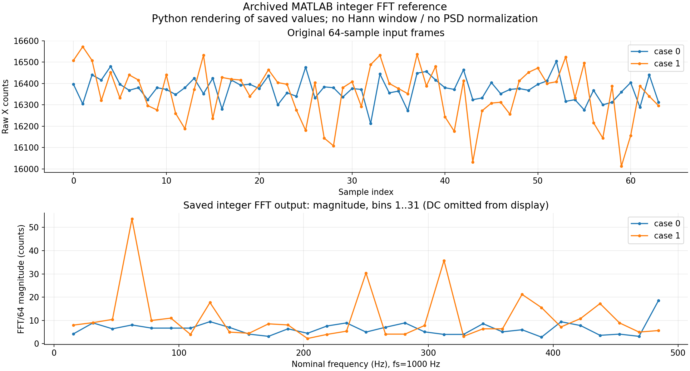

상단은 실측 정상 0번·주입 이상 1번의 raw 64 samples, 하단은 정수 FFT의 주파수별 크기입니다.
FFT 그래프는 bin 1..31을 표시하며 계산에는 DC를 포함한 원본 입력을 사용합니다.
명목 주파수 축은 1 kHz/64, 세로축은 `FFT/64`의 count 크기입니다.

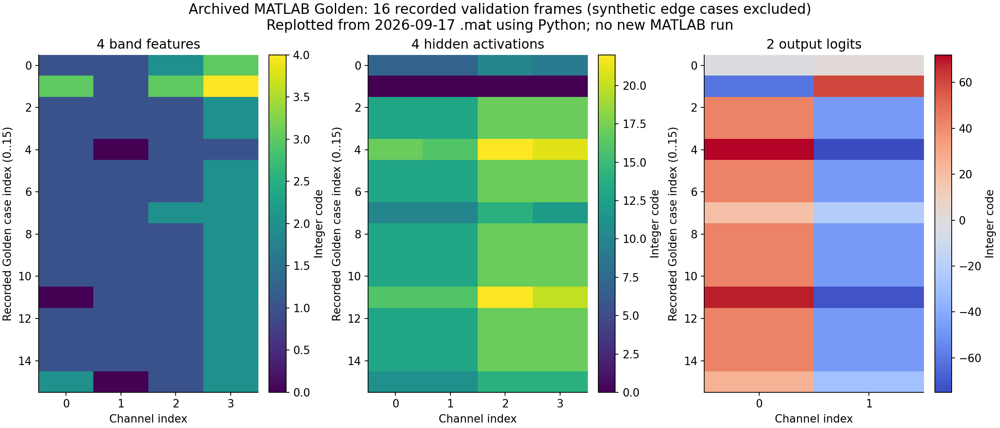

왼쪽부터 특징 4개·은닉 활성값 4개·최종 점수 2개입니다. 각 행은 동일한 case이므로 입력 특징이
ReLU와 재양자화를 거쳐 최종 판정으로 바뀌는 과정을 따라갈 수 있습니다.
logits는 정상·이상 클래스의 상대적인 정수 점수이며, 더 큰 점수의 클래스를 선택합니다.

Golden 입력은 **실측 검증 frame 16개 + 산술 경계 시험 4개**로 구성합니다.
위 그래프에는 실측 16개를, 전체 정수 검증에는 20개를 사용합니다.
산술 경계 입력은 영·최대 양수·최대 음수·impulse이며, 실측 전용 재생은 원본 360개 window를 사용합니다.

두 그림은 **MATLAB에 저장된 기준값의 FFT·NPU 결과 시각화**입니다.
20개 기준 입력의 저장 배열과 독립 정수 계산의 일치를 확인했습니다.
[기준 데이터](docs/evidence/2026-09-17_matlab_reference.mat) ·
[데이터·그림 출처](docs/SCREENSHOT_PROVENANCE.md) ·
[그래프 생성 코드](tools/render_readme_npu_reference.py)

### 14-5. 실측 3D 스펙트럼과 MATLAB 분석 출력

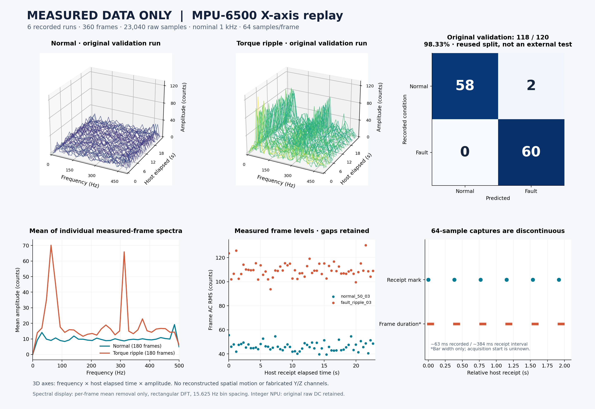

실측 X축 프레임을 **주파수 × 프레임 × 스펙트럼 크기**로 표시한 Python 검증 미리보기입니다.
평균 제거·rectangular DFT 크기를 사용하며, MATLAB 분석은 periodic-Hann PSD [counts²/Hz]를 출력합니다.

| MATLAB에서 생성하는 그림 | 확인하는 내용 |
|---|---|
| `measured_raw_frames.png` | 각 run의 raw counts와 프레임 내 실측 샘플 시각 |
| `measured_spectrum_3d.png` | 6개 run의 periodic-Hann PSD waterfall, counts²/Hz |
| `measured_quality.png` | AC RMS·DC·샘플 간격 표준편차·호스트 수신 간격 |
| `measured_confusion.png` | 기존 학습/검증 run을 나눈 혼동행렬 |
| `*_measured.png` | 기록된 모터 목표·속도·PWM·적분값·상태 |

각 PSD는 원본의 독립된 64-sample frame을 분석하며 단위는 counts²/Hz입니다.
윈도우별 host 시각과 프레임 내 실측 샘플 간격을 함께 기록합니다.

| 경로 | 입력과 목적 | 실행 |
|---|---|---|
| 정수 Golden 검증 | 기존 FFT/NPU의 MATLAB·Simulink 중간값 비교 | `RUN_MATLAB_CHECKS` |
| **2차 실측 전용** | 원본 X축 360 windows + 모터 telemetry 5개, 19,381 records 재생 | `RUN_MEASURED_STUDY` |
| 6자유도 연구 | 가정한 질량·강성·감쇠와 가진력으로 XYZ·회전 응답 분석 | `RUN_RESEARCH_STUDY('ripple')` |

실측 경로는 X축 기록의 주파수별 변화를, 6자유도 경로는 가정한 질량·강성·감쇠에 따른
XYZ·회전 응답을 분석합니다. 두 경로의 입력과 출력 단위를 각각 관리합니다.
두 경로에는 함수 목적·입출력·단위와 `% [주1]` 형식의 한국어 설명 주석을 추가했습니다.

스터디 코드의 검증 근거는 **독립 Python 수치 참조와 정적 구문 검사**입니다.
MATLAB에서는 각 진입점이 `.slx`를 생성하고 분석·재생 결과를 `reports/`에 저장하도록 구성했습니다.

[실측 재현 가이드](docs/MATLAB_SIMULINK_MEASURED.md) ·
[6자유도 연구 가이드](docs/MATLAB_SIMULINK_RESEARCH.md) ·
[코드 각주 읽기 순서](docs/STUDY_CODE_NOTES.md)

실제 MATLAB 그림과 Simulink 루트·하위 블록 이미지는 다음 순서로 내보냅니다.

```matlab
RUN_MATLAB_CHECKS
RUN_MEASURED_STUDY
EXPORT_README_FIGURES
```

[`EXPORT_README_FIGURES.m`](EXPORT_README_FIGURES.m)은 실측 replay 비교가 통과한 경우에만
`docs/images/matlab_exports/`에 실제 MATLAB PNG/FIG와 Simulink 다이어그램을 저장합니다.
내보내기 함수의 정적 구문 검사를 완료했습니다.

### 14-6. 검증 자료 안내

| 대상 | 검증 근거 | 자료 |
|---|---|---|
| VHDL RTL | XSim 13개 시험·클럭별 출력 비교 | [HDL 로그·지문](docs/evidence/readability_complete_2026-11-15/) |
| C 정수 모델 | 10,651개 입력의 중간값·최종 결과 비교 | [정수 모델 검증](docs/evidence/readability_complete_2026-11-15/golden_equivalence.json) |
| ARM 펌웨어 | 명령 20개 시나리오·PC 검사 8개 경우·Cortex-A9 빌드 | [펌웨어 검증](docs/evidence/readability_complete_2026-11-15/firmware_equivalence.json) |
| 보드 계측·routed 결과 | 날짜별 원본 CSV·사진·보고서 | [자료 출처](docs/SCREENSHOT_PROVENANCE.md) |
| MATLAB 정수 기준 모델 | 2026-09-17에 저장된 MATLAB 배열·Simulink 모델 | [MATLAB 기준 데이터](docs/evidence/2026-09-17_matlab_reference.mat) |
| 실측·6자유도 스터디 코드 | 독립 Python 수치 참조·정적 구문 검사 | [실측 가이드](docs/MATLAB_SIMULINK_MEASURED.md) · [연구 가이드](docs/MATLAB_SIMULINK_RESEARCH.md) |

## 15. 빌드와 소프트웨어 연동

MATLAB에서 `Project07_VibrationNPU`를 현재 폴더로 선택합니다.

```matlab
RUN_MATLAB_CHECKS                 % 기존 정수 Golden 및 Simulink 검증
RUN_MEASURED_STUDY                % 실제 기록만 재생하는 별도 스터디
RUN_RESEARCH_STUDY('ripple')      % 가정 기반 6자유도 연구
```

PC 도구는 이 README가 있는 폴더에서 실행합니다.

VHDL RTL 검증은 다음 명령으로 실행합니다.

```bash
python3 tools/run_vhdl_validation.py
python3 tools/check_vhdl_preservation.py
```

검사 결과는 실행별 폴더에 저장합니다. 공식 sim/build는 현재 소스 지문에 맞는
MATLAB 선행 검증을 확인하며, 아래 순서로 실행합니다.

```bash
python3 -m pip install -r requirements.txt
python3 tools/offline_check.py
python3 tools/run.py sim
python3 tools/run.py build
```

| 사용하는 자료 | 실행 범위 |
|---|---|
| 전체 저장소 | Golden·실측·6자유도 연구 및 `EXPORT_README_FIGURES` |
| `artifacts/matlab_measured_input.zip` | 실측 원본을 포함한 `RUN_MEASURED_STUDY`; 그림은 `reports/measured/`에 생성 |
| `artifacts/matlab_research_input.zip` | 가정 기반 `RUN_RESEARCH_STUDY`와 Golden; 실측 CSV·모터 기록 미포함 |

실측 ZIP의 진입점은 `RUN_MEASURED_STUDY`입니다. 전체 그림 내보내기는 전체 저장소에서
`RUN_MATLAB_CHECKS → RUN_MEASURED_STUDY → EXPORT_README_FIGURES` 순서로 실행합니다.

공식 sim/build의 MATLAB 검증 마커는 현재 source digest를 기준으로 관리합니다.
Vivado 2024.2와 Zybo Z7-20 board files가 필요합니다. 경로 설정·Vitis·UART 명령은
[Vitis 가이드](docs/VITIS_2024_2.md), 실측 수집·재학습은 [데이터 가이드](docs/REAL_DATASET.md)를 따릅니다.
