# System Architecture & Verification

**진동 분류 NPU 기반 모터 속도 제어·보호 시스템 — Zybo Z7-20 / Zynq-7000 SoC**

PS는 센서 수집·윈도우 구성·정수 기준 연산·통신을 담당하고,
PL은 FFT·INT8 NPU 추론과 인코더 기반 속도 제어·안전 보호를 수행한다.

복사해 사용할 [텍스트 블록도](PORTFOLIO_ARCHITECTURE.txt)와 아래 Mermaid 원본을 함께 제공한다.
실제 신호명·폭·방향이 들어간 [모듈·신호 도면 3장](architecture/README.md)도 제공한다.
상태와 실행 조건은 [핵심 FSM 및 시스템별 동작도 11장](state_diagrams/README.md)에서 확인할 수 있다.

## 포트폴리오용 블록도

```mermaid
flowchart LR
    PC["PC 모니터링<br/>명령 · raw 기록 · telemetry"]
    IMU["MPU-6500<br/>모터 하우징 X축 진동"]
    DRIVER["L298N<br/>모터 드라이버"]
    MOTOR["DC 모터<br/>A/B 인코더"]

    subgraph SOC["Zybo Z7-20 · Zynq-7000 SoC"]
        direction LR
        subgraph PS["CPU 영역 · Zynq PS / ARM Cortex-A9 / C"]
            direction TB
            APP["센서 수집 · 윈도우 구성<br/>signed INT16 × 64 samples"]
            GOLDEN["C 정수 Golden Model<br/>FFT · 특징 · MLP · PL 결과 비교"]
            SERVICE["UART 명령 · telemetry<br/>게인 설정 · PS heartbeat"]
            APP --> GOLDEN
        end

        subgraph PL["FPGA 영역 · Zynq PL / 100 MHz / VHDL"]
            direction TB
            AXI["AXI SmartConnect<br/>제어 · 상태 · 데이터 접근"]
            REGS["AXI4-Lite 레지스터<br/>START / DONE · SPI · 모터 설정/상태"]
            SPI["SPI Master · Mode 0<br/>명령 송신 · 1/2바이트 수신"]
            RAMCTRL["AXI BRAM Controller<br/>PS 접근 · Port A"]
            RAM["Dual-Port BRAM · 4 KiB<br/>입력 64개 · 특징/은닉/점수/클래스"]
            CORE["FFT + INT8 NPU 가속기<br/>64-point FFT → 대역 특징 4개<br/>MLP 4 → 4 ReLU → 2 / MAC PE × 2"]
            SAFE["안전 감시<br/>Warning → Derate → Fault Latch<br/>PS heartbeat watchdog"]
            SPEED["인코더 A 속도 추정<br/>펄스 주기 + 창 내 펄스 수"]
            PI["고정소수점 PI<br/>Anti-windup / 100 Hz"]
            RUN["운전 · duty 선택<br/>목표속도 · 출력 제한 · 차단"]
            PWM["PWM 생성 · 20 kHz<br/>주기 경계 duty 갱신"]
            QUAD["A/B 위상 판정<br/>방향 · 위치 · 오류 진단"]

            AXI <--> REGS
            REGS <--> SPI
            AXI <--> RAMCTRL
            RAMCTRL <-->|"Port A"| RAM
            RAM <-->|"Port B · 입력 읽기 / 결과 기록"| CORE
            CORE -->|"class_valid / class_id"| SAFE
            REGS -->|"PS heartbeat"| SAFE
            SAFE -->|"출력 제한 / 차단"| RUN
            SPEED -->|"측정속도"| PI
            RUN -->|"목표속도"| PI
            PI -->|"duty 명령"| RUN
            RUN --> PWM
            REGS -->|"게인 · 모드"| RUN
            REGS -->|"Kp / Ki · anti-windup"| PI
            QUAD -->|"진단 상태"| REGS
        end
        APP <-->|"M_AXI_GP0"| AXI
        SERVICE <-->|"제어 / 상태"| AXI
    end

    PC <-->|"USB-UART"| SERVICE
    IMU <-->|"SPI"| SPI
    PWM -->|"PWM"| DRIVER
    RUN -->|"IN1 / IN2"| DRIVER
    DRIVER --> MOTOR
    MOTOR -->|"Encoder A"| SPEED
    MOTOR -->|"Encoder A/B"| QUAD
    MOTOR -.->|"하우징 진동"| IMU

    subgraph VERIFY["오프라인 분석 & 검증"]
        direction LR
        REPLAY["실측 CSV · 저장 기준값<br/>MATLAB / Simulink 재생·분석"]
        NUMERIC["Python / C Golden / VHDL<br/>정수 중간값 · 결과 일치 비교"]
        TEST["XSim · 펌웨어 비교<br/>클록별 출력 · MMIO · UART"]
        BUILD["Vivado / Vitis<br/>BD · 단위 합성 · 앱 빌드"]
        REPLAY --> NUMERIC --> TEST --> BUILD
    end

    PC -.->|"기록 데이터"| REPLAY

    classDef cpu fill:#eef2f5,stroke:#536879,color:#172b3a;
    classDef fpga fill:#dfedf5,stroke:#496e87,color:#172b3a;
    classDef safety fill:#fff0df,stroke:#aa753b,color:#513915;
    classDef external fill:#f1f1ed,stroke:#777d7b,color:#25322f;
    class APP,GOLDEN,SERVICE cpu;
    class AXI,REGS,SPI,RAMCTRL,RAM,CORE,SPEED,PI,RUN,PWM,QUAD fpga;
    class SAFE safety;
    class PC,IMU,DRIVER,MOTOR external;
```

## 그림 설명

> Zynq PS가 진동 데이터 수집과 통신·기준 연산을 담당하고, PL의 고정소수점 FFT와
> 2-PE INT8 NPU가 정상·이상을 분류한다. 분류 결과와 PS heartbeat를 감시하는 안전 회로가
> 모터 출력을 제한·차단하며, 인코더 기반 PI·PWM 속도 제어는 PL에서 수행한다.

센서 값은 PS가 AXI를 통해 SPI 레지스터에서 읽은 뒤, 64개 샘플로 묶어 BRAM에 기록한다.
BRAM Port B의 입력 읽기와 결과 기록은 `vibration_core` 순서 제어기가 담당한다.
속도 추정에는 Encoder A를 사용하고, A/B 위상은 방향·위치·오류 진단에 사용한다.
MATLAB/Simulink 영역은 기록 데이터의 오프라인 재생·분석 경로다.

## 현재 소프트웨어 검증 기록

| 항목 | 확인 결과 |
|---|---|
| HDL 회귀 검사 | VHDL RTL의 XSim 13개 시험 통과, 기준값·클럭별 출력 비교 |
| C 정수 모델 | 실측 360개 포함 10,651개 시험 입력의 중간값/결과 비교 |
| 펌웨어 프로토콜 | 20개 명령 시나리오의 MMIO·UART 비교 |
| PC 검사 프로그램 | 8개 성공/오류 경우와 결과 구조체 배치 비교 |
| 빌드 | 가속기/모터 단위 합성, BD 검증, Vitis 앱 빌드·링크 |

검증 로그와 소스 지문: [현재 구현 검증 기록](evidence/readability_complete_2026-11-15/README.md).
연결 근거: [Vivado BD 생성](../vivado/create_fourier.tcl),
[가속기 연결](../fourier/vhdl/axi_vibration_struct.vhd),
[모터 연결](../fourier/vhdl/fourier_motor_struct.vhd),
[ARM 모듈](../fourier/firmware/README.md).
