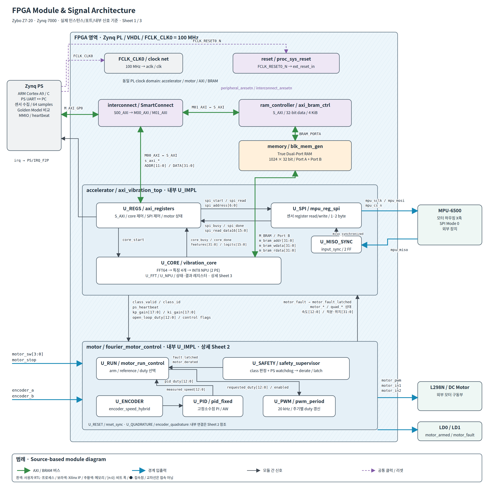

# 모듈·신호 아키텍처

현재 VHDL의 entity/포트/`PORT MAP`, Vivado BD 연결, XDC 외부 핀 이름을 기준으로 작성한
포트폴리오용 구조도다. FPGA 경계 안은 **Zynq PL**, 왼쪽 PS는 같은 Zynq SoC의 ARM 영역이다.
사선 배경과 인터페이스별 색상, 계층 박스로 모듈과 신호를 구분한다.
각 회로의 실행 순서·전이 조건은 [상태천이도와 동작도 11장](../state_diagrams/README.md)에 정리했다.

| 도면 | PNG | 확대용 SVG |
|---|---|---|
| 1. 시스템과 외부 신호 | [전체 구조도](01_system_signals.png) | [벡터 원본](01_system_signals.svg) |
| 2. 모터 내부 연결 | [모터 상세도](02_motor_signals.png) | [벡터 원본](02_motor_signals.svg) |
| 3. FFT/NPU·PE 연결 | [가속기 상세도](03_fft_npu_signals.png) | [벡터 원본](03_fft_npu_signals.svg) |

## 표기

- `인스턴스 / entity`: 예를 들어 `U_RUN / motor_run_control`은 해당 entity의 실제 인스턴스다.
- `U_IMPL`: Vivado 최상위 연결 파일 아래의 구조 구현 계층이다.
- `[12:0]`: 13비트 버스다. 범위를 쓰지 않은 `pid_start`, `class_valid` 등은 1비트 신호다.
- 화살표는 전달 방향을 나타낸다. AXI/BRAM의 양방향 선은 요청·응답을 묶은 인터페이스다.
- 여러 신호를 한 선에 나란히 적은 경우 인터페이스 묶음이며, 새 packed 버스를 만든다는 뜻은 아니다.
- 연결점은 `●`로 표시하고, 점 없는 교차선은 접속하지 않는다.
- 공통 `clk/rst`는 배포 대상으로 묶어서 표시한다. 모터의 `controller_reset`은 PI에 전달된다.

## 중요한 실제 연결

| 연결 | 코드 기준 의미 |
|---|---|
| `accelerator/class_valid`, `class_id` → `motor` | 분류 완료와 판정이 PL 안전 회로에 전달 |
| `U_ENCODER.speed` → `measured_speed[12:0]` → `U_PID.measured` | A 채널의 하이브리드 속도 추정 |
| `U_PID.duty` → `pid_duty[12:0]` → `U_RUN` | PI 결과를 운전 모드·안전 제한과 함께 선택 |
| `U_RUN.duty` → `requested_duty[12:0]` → `U_PWM.duty` | 최종 선택된 duty를 PWM에 전달 |
| `U_RUN.armed` → `armed_command` → `U_SAFETY.armed` | watchdog이 감시하는 운전 명령 |
| `motor_armed = enabled` | 외부 운전 상태는 reset/STOP/fault 조건을 반영한 enable |
| `motor/motor_fault` → `accelerator/motor_fault_latched` | 같은 1비트 신호의 모듈별 포트 이름 |
| `mpu_miso` → `U_MISO_SYNC` → `miso_synchronized` → `U_SPI.miso` | 센서 수신 입력을 두 단계 동기화 |
| `U_FFT.features` → `fft_features[31:0]` → 코어 결과 레지스터 → `U_NPU.features` | 저장된 특징을 NPU가 읽음 |
| `bram_addr[9:0]` → `m_bram_addr[31:0]` | 내부 word 주소를 외부 byte 주소로 변환, 하위 2비트는 0 |

센서 데이터는 PS가 SPI 레지스터에서 읽고 64개 샘플로 구성한 후 BRAM에 기록한다.
Encoder A는 속도 추정에, A/B는 방향·위치·오류 진단에 사용한다.
Sheet 3의 흰색 FSM/결과/BRAM 선택 박스는 `vibration_core` 내부 프로세스와 조합 경로다.

## 원본 신호표

| 파일 | 내용 |
|---|---|
| [board_ports.csv](board_ports.csv) | 사용자 PL 외부 포트 13종의 방향·폭·모듈 대응·XDC package pin |
| [module_ports.csv](module_ports.csv) | entity 20개의 포트 419행 |
| [port_connections.csv](port_connections.csv) | 실제 `PORT MAP` 연결 320행, local signal/식 포함 |
| [signal_manifest.json](signal_manifest.json) | 생성 기준 소스의 SHA-256과 BD net 연결 |

표의 `IN/OUT`은 해당 entity 기준이다. 포트 행 수에는 연결용 최상위 entity도 포함한다.
모든 연결을 한 장에 펼치면 복잡해져, 그림은 핵심 연결을 표시하고 신호표는 전체 포트 맵을 제공한다.

## 포트폴리오 캡션

> 그림. 진동 분류 NPU 기반 모터 제어 시스템의 RTL 모듈 및 신호 연결.
> PS는 AXI를 통해 센서 수집·가속기 실행·상태 조회를 수행하고, PL은 FFT·INT8 NPU와
> 인코더 기반 PI·PWM 제어, 연속 이상·heartbeat 안전 감시를 처리한다.

생성 명령: `python3 tools/render_signal_architecture.py`.
레이아웃과 표기 원본: [render_signal_architecture.py](../../tools/render_signal_architecture.py).
실제 연결 근거: [Vivado BD](../../vivado/create_fourier.tcl),
[가속기](../../fourier/vhdl/axi_vibration_struct.vhd),
[모터](../../fourier/vhdl/fourier_motor_struct.vhd),
[FFT/NPU 코어](../../fourier/vhdl/vibration_core_fsm.vhd).
