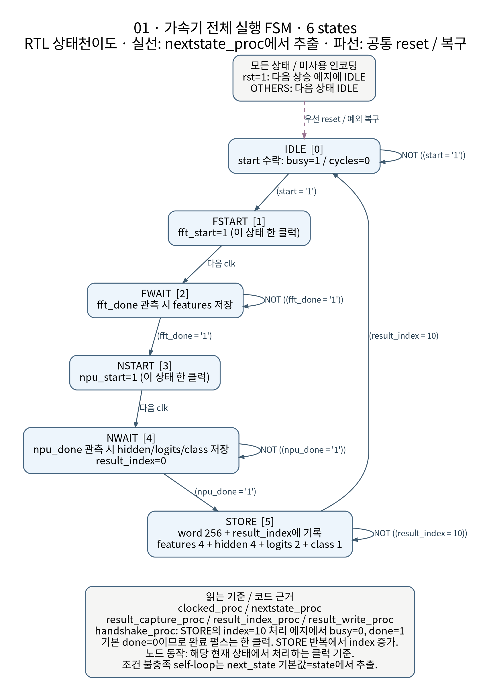

# 시스템별 상태천이도·동작도

포트폴리오 본문에는 가속기 순서 제어·FFT·NPU·PI의 **핵심 FSM 4장**을 권장한다.
전체 자료는 **11장**이며, 현재 VHDL의 **20개 entity**를 도면별로 대응했다.
코드의 상태 이름·조건·인코딩을 유지하고 리셋·대기 반복·완료 처리를 표시했다.

## 도면 목록

| 번호 / 도면 | 종류 | PNG | 확대용 SVG | 편집용 DOT |
|---|---|---|---|---|
| 1. 가속기 전체 실행 | RTL FSM | [보기](01_core_fsm.png) | [확대](01_core_fsm.svg) | [원본](01_core_fsm.dot) |
| 2. FFT64·대역 특징 | RTL FSM | [보기](02_fft_fsm.png) | [확대](02_fft_fsm.svg) | [원본](02_fft_fsm.dot) |
| 3. INT8 NPU·MAC PE | RTL FSM | [보기](03_npu_fsm.png) | [확대](03_npu_fsm.svg) | [원본](03_npu_fsm.dot) |
| 4. PI·anti-windup | RTL FSM | [보기](04_pi_fsm.png) | [확대](04_pi_fsm.svg) | [원본](04_pi_fsm.dot) |
| 5. SPI·입력 동기화 | 동작도 | [보기](05_spi_behavior.png) | [확대](05_spi_behavior.svg) | [원본](05_spi_behavior.dot) |
| 6. 모터 운전·출력 선택 | 동작도 | [보기](06_motor_run_behavior.png) | [확대](06_motor_run_behavior.svg) | [원본](06_motor_run_behavior.dot) |
| 7. 안전·watchdog·fault latch | 동작도 | [보기](07_safety_behavior.png) | [확대](07_safety_behavior.svg) | [원본](07_safety_behavior.dot) |
| 8. AXI 수신·응답·상태 | 동작도 | [보기](08_axi_behavior.png) | [확대](08_axi_behavior.svg) | [원본](08_axi_behavior.dot) |
| 9. 하이브리드 속도·divider | 동작도 | [보기](09_speed_divider_behavior.png) | [확대](09_speed_divider_behavior.svg) | [원본](09_speed_divider_behavior.dot) |
| 10. A/B 위상·위치·진단 | 동작도 | [보기](10_quadrature_behavior.png) | [확대](10_quadrature_behavior.svg) | [원본](10_quadrature_behavior.dot) |
| 11. 리셋·PWM | 동작도 | [보기](11_reset_pwm_behavior.png) | [확대](11_reset_pwm_behavior.svg) | [원본](11_reset_pwm_behavior.dot) |

## 먼저 볼 그림

가속기 전체 실행은 `IDLE → FSTART → FWAIT → NSTART → NWAIT → STORE → IDLE`다.
`FWAIT`, `NWAIT`, `STORE`에서는 완료 조건까지 머무르며, 마지막 BRAM 기록 처리 에지에 `done`이 발생한다.

## 표기와 범위

- **1~4번은 실제 RTL FSM**이다. `nextstate_proc`의 `CASE state`, `IF`, `next_state` 대입에서 화살표를 추출한다.
- 파선의 공통 reset 표기는 각 상태에 적용된다. 1~4번 FSM의 reset은 상승 에지에서 적용된다.
- 조건이 거짓일 때의 self-loop도 `next_state <= state` 기본값을 반영한다.
- 노드 안 동작은 해당 **현재 상태를 처리하는 활성 클럭 에지** 기준이다. 조합 출력은 별도로 표시한다.
- **5~11번은 회로의 동작도**다. 설명용 모드·단계 이름을 RTL의 추가 상태나 추가 클럭으로 해석하지 않는다.
- 10번은 이전 A/B 위상과 현재 위상의 실제 전이다. `state`라는 변수 이름만으로 제어 FSM으로 분류하지 않는다.
- 서로 다른 패널은 동시에 동작하는 프로세스다. 패널 배치 순서가 실행 순서를 뜻하지 않는다.
- `fault_latch`는 독립 entity이며 현재 상위 RTL에서는 인스턴스되지 않는다. 실제 통합 안전 경로는 `safety_supervisor`다.
- `axi_vibration_top`, `fourier_motor_control`은 `U_IMPL` 연결용 최상위다. `*_impl`은 하위 모듈 연결 계층이며 별도 상태를 추가하지 않는다.
- `vibration_types`, `vibration_regs`는 타입·함수·주소 상수 패키지라 자체 상태천이도가 없다.

## 코드와 도면 대응

| entity | 도면 | 근거 소스 |
|---|---|---|
| `axi_registers` | [08](08_axi_behavior.svg) | [axi_registers_rtl.vhd](../../fourier/vhdl/axi_registers_rtl.vhd) |
| `axi_vibration_impl` | [08](08_axi_behavior.svg) | [axi_vibration_struct.vhd](../../fourier/vhdl/axi_vibration_struct.vhd) |
| `axi_vibration_top` | [08](08_axi_behavior.svg) | [axi_vibration_top.vhd](../../fourier/vhdl/axi_vibration_top.vhd) |
| `encoder_quadrature` | [10](10_quadrature_behavior.svg) | [encoder_quadrature_rtl.vhd](../../fourier/vhdl/encoder_quadrature_rtl.vhd) |
| `encoder_speed_hybrid` | [09](09_speed_divider_behavior.svg) | [encoder_speed_rtl.vhd](../../fourier/vhdl/encoder_speed_rtl.vhd) |
| `fault_latch` | [07](07_safety_behavior.svg) | [fault_latch_rtl.vhd](../../fourier/vhdl/fault_latch_rtl.vhd) |
| `fft64_features` | [02](02_fft_fsm.svg) | [fft64_features_fsm.vhd](../../fourier/vhdl/fft64_features_fsm.vhd) |
| `fourier_motor_control` | [06](06_motor_run_behavior.svg) | [fourier_motor_control.vhd](../../fourier/vhdl/fourier_motor_control.vhd) |
| `fourier_motor_impl` | [06](06_motor_run_behavior.svg) | [fourier_motor_struct.vhd](../../fourier/vhdl/fourier_motor_struct.vhd) |
| `input_sync` | [05](05_spi_behavior.svg) | [input_sync_rtl.vhd](../../fourier/vhdl/input_sync_rtl.vhd) |
| `mac_pe` | [03](03_npu_fsm.svg) | [mac_pe_rtl.vhd](../../fourier/vhdl/mac_pe_rtl.vhd) |
| `motor_run_control` | [06](06_motor_run_behavior.svg) | [motor_run_control_rtl.vhd](../../fourier/vhdl/motor_run_control_rtl.vhd) |
| `mpu_reg_spi` | [05](05_spi_behavior.svg) | [mpu_spi_fsm.vhd](../../fourier/vhdl/mpu_spi_fsm.vhd) |
| `npu_2pe` | [03](03_npu_fsm.svg) | [npu_2pe_fsm.vhd](../../fourier/vhdl/npu_2pe_fsm.vhd) |
| `pid_fixed` | [04](04_pi_fsm.svg) | [pid_controller_fsm.vhd](../../fourier/vhdl/pid_controller_fsm.vhd) |
| `pwm_period` | [11](11_reset_pwm_behavior.svg) | [pwm_period_rtl.vhd](../../fourier/vhdl/pwm_period_rtl.vhd) |
| `reset_sync` | [11](11_reset_pwm_behavior.svg) | [reset_sync.vhd](../../common/reset_sync.vhd) |
| `safety_supervisor` | [07](07_safety_behavior.svg) | [safety_supervisor_rtl.vhd](../../fourier/vhdl/safety_supervisor_rtl.vhd) |
| `unsigned_divider` | [09](09_speed_divider_behavior.svg) | [unsigned_divider_rtl.vhd](../../fourier/vhdl/unsigned_divider_rtl.vhd) |
| `vibration_core` | [01](01_core_fsm.svg) | [vibration_core_fsm.vhd](../../fourier/vhdl/vibration_core_fsm.vhd) |

## 상태 전이 표

다음 표의 상태와 조건은 현재 소스에서 추출한 결과다. `다음 clk`는 무조건 전이다.
`rst=1`에서는 상태 레지스터가 `IDLE`로 초기화되고, 미사용 인코딩의 `OTHERS`도 다음 상태가 `IDLE`다.

### `vibration_core` · 6 states

| 현재 상태 | 조건 | 다음 상태 |
|---|---|---|
| `IDLE` | `(start = '1')` | `FSTART` |
| `IDLE` | `NOT ((start = '1'))` | `IDLE` |
| `FSTART` | `다음 clk` | `FWAIT` |
| `FWAIT` | `(fft_done = '1')` | `NSTART` |
| `FWAIT` | `NOT ((fft_done = '1'))` | `FWAIT` |
| `NSTART` | `다음 clk` | `NWAIT` |
| `NWAIT` | `(npu_done = '1')` | `STORE` |
| `NWAIT` | `NOT ((npu_done = '1'))` | `NWAIT` |
| `STORE` | `(result_index = 10)` | `IDLE` |
| `STORE` | `NOT ((result_index = 10))` | `STORE` |

### `fft64_features` · 9 states

| 현재 상태 | 조건 | 다음 상태 |
|---|---|---|
| `IDLE` | `(start = '1')` | `LREQ` |
| `IDLE` | `NOT ((start = '1'))` | `IDLE` |
| `LREQ` | `다음 clk` | `LWAIT` |
| `LWAIT` | `다음 clk` | `LSTORE` |
| `LSTORE` | `(load_index = 63)` | `READ_STATE` |
| `LSTORE` | `NOT ((load_index = 63))` | `LREQ` |
| `READ_STATE` | `다음 clk` | `MULT` |
| `MULT` | `다음 clk` | `WRITE_STATE` |
| `WRITE_STATE` | `last_pair AND last_group AND last_stage` | `FACC` |
| `WRITE_STATE` | `NOT (last_pair AND last_group AND last_stage)` | `READ_STATE` |
| `FACC` | `(frequency_bin = 31)` | `FINISH` |
| `FACC` | `NOT ((frequency_bin = 31))` | `FACC` |
| `FINISH` | `다음 clk` | `IDLE` |

### `npu_2pe` · 4 states

| 현재 상태 | 조건 | 다음 상태 |
|---|---|---|
| `IDLE` | `(start = '1')` | `INIT` |
| `IDLE` | `NOT ((start = '1'))` | `IDLE` |
| `INIT` | `다음 clk` | `MAC` |
| `MAC` | `(input_index = 3)` | `PACK` |
| `MAC` | `NOT ((input_index = 3))` | `MAC` |
| `PACK` | `(neuron_pair = 2)` | `IDLE` |
| `PACK` | `NOT ((neuron_pair = 2))` | `INIT` |

### `pid_fixed` · 11 states

| 현재 상태 | 조건 | 다음 상태 |
|---|---|---|
| `IDLE` | `(start = '1')` | `FILTER` |
| `IDLE` | `NOT ((start = '1'))` | `IDLE` |
| `FILTER` | `다음 clk` | `PRODUCTS` |
| `PRODUCTS` | `다음 clk` | `PRODUCTS_HI` |
| `PRODUCTS_HI` | `다음 clk` | `PROPOSE_ADD` |
| `PROPOSE_ADD` | `다음 clk` | `PROPOSE_SUB` |
| `PROPOSE_SUB` | `다음 clk` | `SELECT_STATE` |
| `SELECT_STATE` | `다음 clk` | `OUTPUT_ADD` |
| `OUTPUT_ADD` | `다음 clk` | `OUTPUT_SUB` |
| `OUTPUT_SUB` | `다음 clk` | `CLAMP` |
| `CLAMP` | `다음 clk` | `FINISH` |
| `FINISH` | `다음 clk` | `IDLE` |

## 생성과 확인

`python3 tools/render_state_diagrams.py`로 DOT·SVG·PNG와 상태/소스 매니페스트를 생성한다.
렌더링에는 Graphviz `dot`과 `Noto Sans CJK KR` 글꼴을 사용한다.
상태 전이 추출, 20개 entity 대응, 소스 SHA-256은 [state_manifest.json](state_manifest.json)에 기록한다.
5~11번은 소스 프로세스를 읽고 작성한 설명도이므로 코드 변경 시 조건과 우선순위도 함께 검토한다.

[모듈·신호 연결도](../architecture/README.md) · [포트폴리오 전체 아키텍처](../PORTFOLIO_ARCHITECTURE.md)
